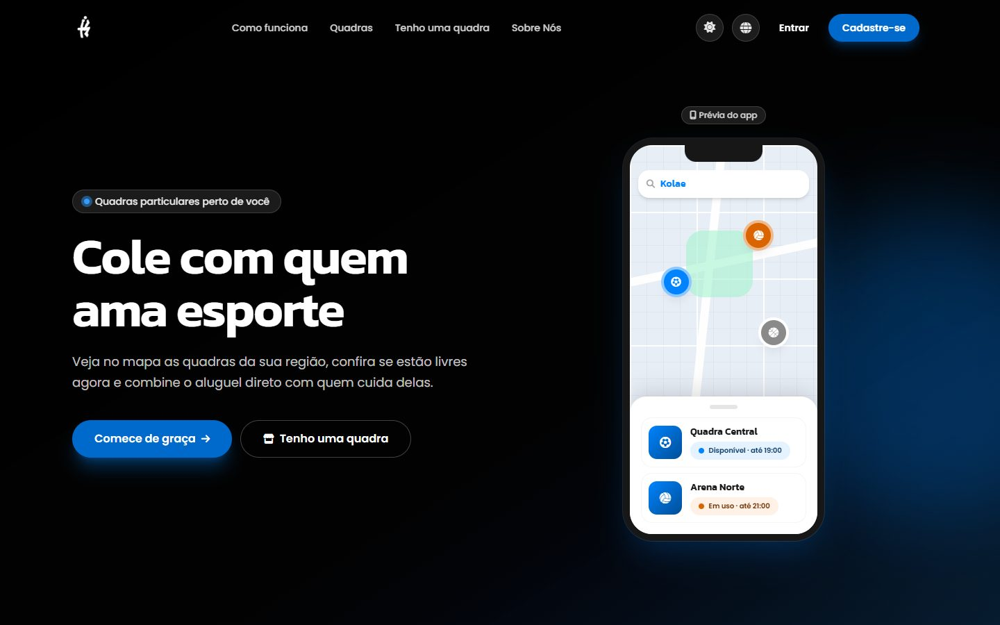
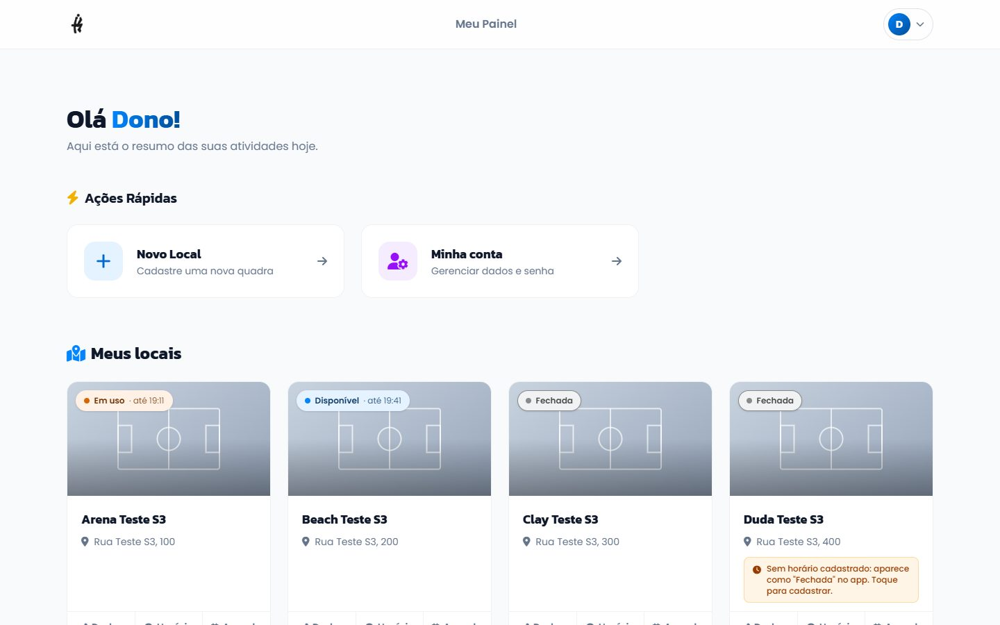
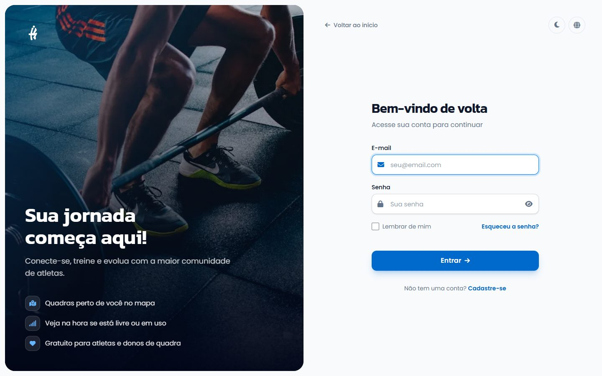

# Kolae 🏅

[](https://github.com/Slengm4n/Kolae/releases/latest)


O **Kolae** conecta atletas a quadras esportivas particulares. Quem joga encontra quadras perto de si e vê **na hora** se cada uma está livre, em uso ou fechada; quem é dono de quadra cadastra o espaço, define o horário de funcionamento e agenda as partidas, e o status muda sozinho no site e no app.

Projeto Integrador da FATEC Ferraz de Vasconcelos: este repositório é o **site e a API**; o app mobile (React Native + Expo) fica em [`Thesatiru/kolae-mobile`](https://github.com/Thesatiru/kolae-mobile) e consome a API daqui.

🔗 **[Acesse o projeto ao vivo](https://kolae.online)**



| Painel do dono, com o status de cada quadra ao vivo | Entrada no Kolae |
| :---: | :---: |
|  |  |

---

## 🆕 Novidades da v1.6 (versão de entrega)

* **Status ao vivo:** cada quadra aparece como Disponível, Em uso ou Fechada, calculado pelo horário de funcionamento e pelas partidas agendadas. A mesma regra vale no site, na API e no app.
* **Painel do dono completo:** abas Visão geral, Dados, Horário, Agenda e Fotos, com guia passo a passo e a lista "Quadra completa".
* **Para quem joga:** página `/quadras` com busca, filtros e mapa, e página pública de cada quadra com "Falar com o dono" pelo WhatsApp e QR Code para imprimir.
* **Segurança:** proteção contra CSRF, limite de tentativas de login, "lembrar de mim", senha mínima de 8 caracteres, CNPJ obrigatório para gerenciar quadras e confirmação de e-mail.
* **Acabamento:** telas de entrada redesenhadas, avisos e confirmações no visual do Kolae, tema automático, fotos otimizadas com miniaturas, Termos de Uso e Política de Privacidade.

Histórico completo no [CHANGELOG](CHANGELOG.md).

---

## ✨ Funcionalidades

### 🏃 Para quem joga
* **Quadras perto de você:** lista e mapa com filtros (esporte, disponível agora, coberta, iluminação, preço) e "Perto de mim".
* **Página da quadra:** fotos, estrutura, preço, horário, horários ocupados do dia (sem nomes) e contato com o dono pelo WhatsApp; o link mostra foto e nome na prévia do WhatsApp.
* **Conta:** cadastro com confirmação de e-mail, login com "lembrar de mim", esqueci a senha por e-mail, perfil com foto, troca de senha, tema claro, escuro ou automático e 7 idiomas.

### 🏟️ Para donos de quadra
* **Validação de CNPJ:** obrigatória para cadastrar e gerenciar quadras.
* **Cadastro em passos:** piso, capacidade, comodidades, esportes, preço (valor, grátis ou não informado), descrição, endereço pelo CEP e fotos.
* **Horário e agenda:** horário de funcionamento por dia da semana e partidas agendadas, que mudam o status da quadra na hora.
* **Fotos:** até 10 por quadra, com capa e ordem, otimizadas no envio.
* **Visão geral:** a quadra como aparece no app, o dia de hoje, a lista "Quadra completa" e o QR Code.

### 🛠️ Painel administrativo
* Usuários, modalidades esportivas e quadras, mapa de todas as quadras e o botão "Otimizar fotos".

---

## 🛠️ Tecnologias

Arquitetura **MVC própria** em PHP, sem framework.

* **Backend:** PHP 8.2+
* **API:** REST em `/api/v1` no formato do Laravel, autenticação JWT ([contrato da API](docs/api.md))
* **Frontend:** HTML, Tailwind CSS v4, Vite e JavaScript puro; mapas com Leaflet + OpenStreetMap
* **Banco:** MySQL / MariaDB, modelado em [`database/kolae.dbml`](database/kolae.dbml); mudanças por scripts em [`database/patches/`](database/patches/)
* **E-mail:** PHPMailer pelo Titan (`nao-responda@kolae.online`)
* **Internacionalização:** 7 idiomas (`lang/`)
* **Testes:** scripts PHP em `tests/` (rodam no GitHub Actions antes de cada deploy) e testes de clique com Puppeteer em `tests/e2e/`
* **CI/CD:** GitHub Actions → testes → deploy por FTP na HostGator

---

## 🚀 Como rodar localmente

Toda a documentação (decisões, contrato da API, modelo de status, hospedagem) está indexada em **[docs/README.md](docs/README.md)**. O passo a passo completo (XAMPP, banco, `config.php`, problemas comuns e como conectar o app) está em **[docs/setup.md](docs/setup.md)**. Resumo:

### Pré-requisitos
* XAMPP (ou similar) com PHP 8.2+ e MySQL/MariaDB
* Composer
* Node.js, só para alterar CSS/JS ou rodar os testes de clique (os arquivos compilados já estão no repositório)

### Instalação

1. **Clone o repositório** e deixe-o acessível em `/kolae` no Apache (no XAMPP, `htdocs/kolae`):
```bash
git clone https://github.com/Slengm4n/Kolae.git
```

2. **Dependências PHP:**
```bash
composer install
```

3. **Banco:** crie o banco `kolae_db` (`utf8mb4_unicode_ci`) e importe [`database/schema.sql`](database/schema.sql).

4. **Configuração:** copie `config.example.php` para `config.php` e preencha banco, chaves de criptografia, `JWT_SECRET` e, se quiser enviar e-mails, o bloco `SMTP_*`.

5. **Assets (opcional):**
```bash
npm install
npm run build   # ou npm run watch durante o desenvolvimento
```

6. **Acesse** `http://localhost/kolae` (ou `http://localhost:8080/kolae`, se o Apache estiver na 8080).

### Testes
```bash
php tests/venue_schedule_test.php   # regras do status e da agenda, sem banco
npm run test:e2e                    # testes de clique no navegador (19 roteiros, uns 12 minutos)
```
Detalhes em [docs/setup.md](docs/setup.md#testes) e [tests/e2e/README.md](tests/e2e/README.md).

---

## ☁️ Deploy

Cada `push` na branch `main` publica na produção (`https://kolae.online`) pelo GitHub Actions:

1. **Testes:** sintaxe de todo o PHP e os testes de `tests/` num banco descartável. **Se algum falhar, a produção não muda.**
2. Dependências (`composer install --no-dev`).
3. Envio dos arquivos por FTP.

Em pull request para a `main`, roda só a etapa de testes (o PR mostra ✓ ou ✗ antes do merge). Mudanças no banco não entram no deploy: os scripts de `database/patches/` são aplicados à mão no phpMyAdmin da produção ([docs/hospedagem.md](docs/hospedagem.md)).

---

## 👥 Contribuição

Projeto desenvolvido em dupla, com fluxo baseado em Pull Requests:

* Uma branch por tarefa (`feat/...`, `fix/...`, `docs/...`, `ci/...`), com PR para a `main`. A `main` vai direto para produção.
* A `develop` é um espelho da `main`, atualizada após cada merge.
* Versionamento [SemVer](https://semver.org/lang/pt-BR/) com tags `vX.Y.Z`: minor para entregas de sprint, patch para correções. Mudanças registradas no [CHANGELOG](CHANGELOG.md).

---

## 📄 Licença

Este projeto está licenciado sob a licença **MIT**.
